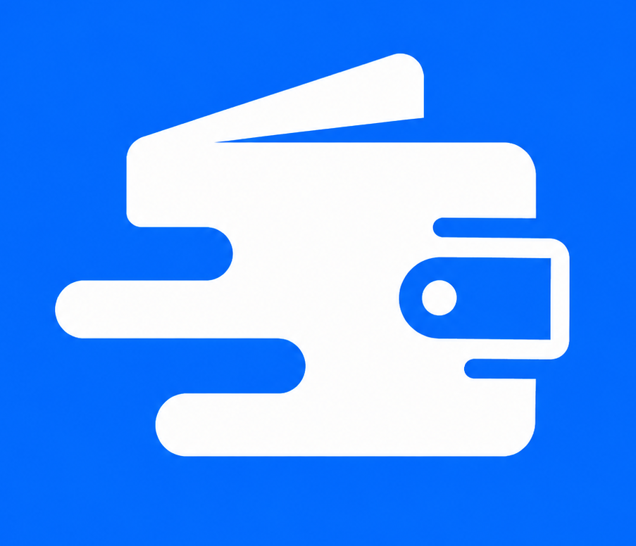
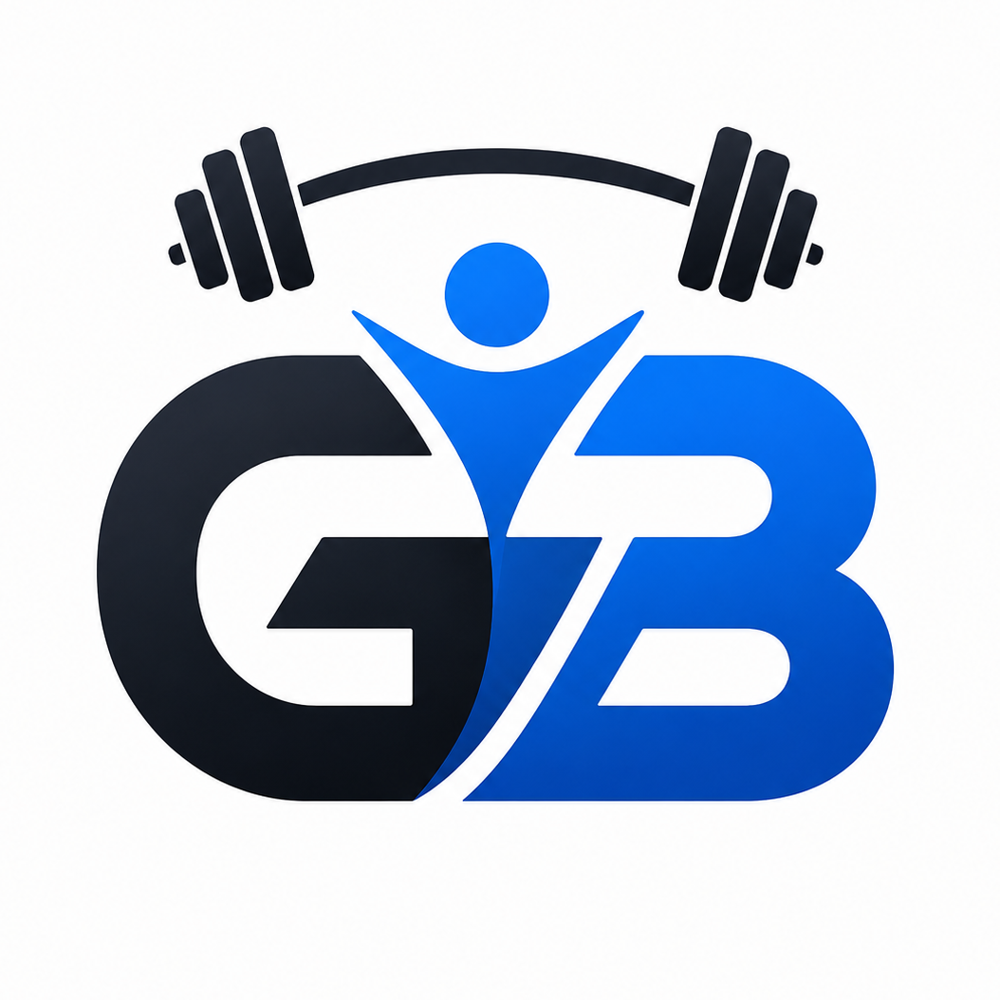
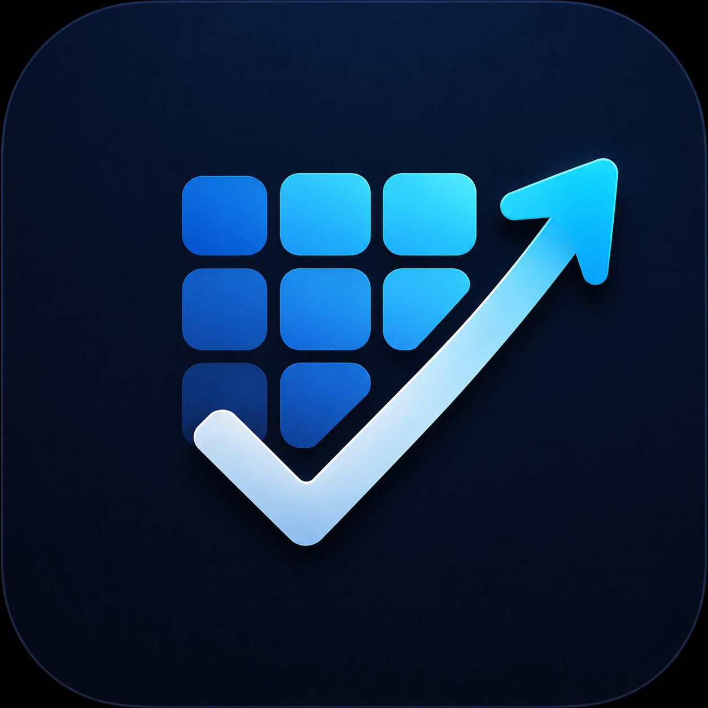
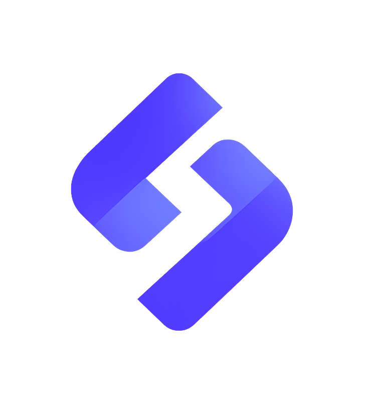
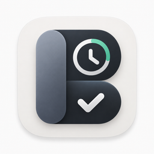
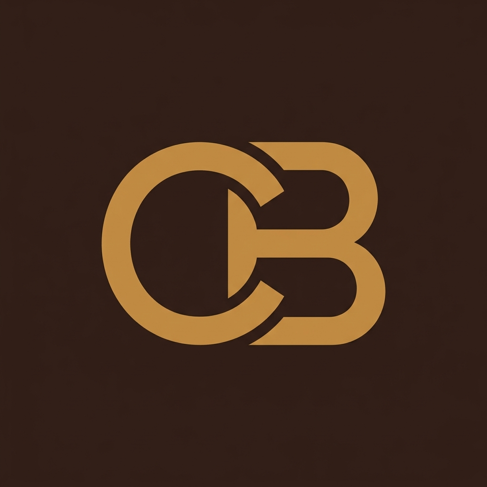
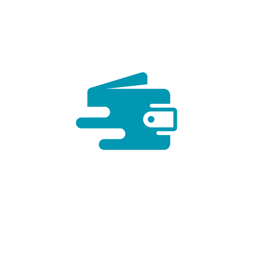

# 🌐 Samyukt Unified Ecosystem Registry (Apps & Websites)

[](app.json)
[](app.json)
[](app.json)
[](https://samyukt.pro)
[](https://github.com/kachakaran6)

Centralized application catalog, web platforms registry, and static asset CDN for **[Samyukt](https://samyukt.pro)** and ecosystem products. This repository serves as the **Single Source of Truth (SSOT)** for dynamically feeding live showcases, portfolio catalogs, and discovery hubs.

---

## 🚀 Live Endpoints

| Resource | URL |
| :--- | :--- |
| **Direct Raw JSON** | `https://raw.githubusercontent.com/kachakaran6/Application-json/main/app.json` |
| **Asset Base CDN** | `https://raw.githubusercontent.com/kachakaran6/Application-json/main/images/` |

---

## 🎯 Supported Statuses

Manage any product lifecycle directly through the `status` key in `app.json`:

| Status Value | Meaning | Samyukt Display Badge |
| :--- | :--- | :--- |
| `"production"` / `"published"` | Publicly live on Google Play or web domain | **Live / Active** (Green) |
| `"closed_testing"` | Active closed-testing track / restricted preview | **Closed Testing** (Purple) |
| `"in_progress"` | Under active engineering / development | **In Progress** (Blue) |
| `"coming_soon"` | Upcoming release / pre-registration | **Coming Soon** (Amber) |
| `"draft"` | Internal staging / not yet launched | **Draft / Staging** (Gray) |

---

## 📱 Mobile Applications Showcase

| App | Name & Package | Status | Description | Play Store |
| :---: | :--- | :---: | :--- | :---: |
|  | **Vault X**<br>`com.vaultx.vault_x` |  | The ultimate link vault. Save, organize, and secure your digital bookmarks effortlessly. | [View App](https://play.google.com/store/apps/details?id=com.vaultx.vault_x) |
|  | **Trust Tracker**<br>`com.trusttracker.trust_tracker_flutter` |  | A secure personal finance app to effortlessly track your subscriptions and manage daily expenses. | [View App](https://play.google.com/store/apps/details?id=com.trusttracker.trust_tracker_flutter) |
|  | **SnapDocs**<br>`com.snapdocs.app` |  | Offline secure document storage application. | [View App](https://play.google.com/store/apps/details?id=com.snapdocs.app) |
|  | **Noctune**<br>`com.noctune.music` |  | Modern music player for music lovers who want to listen offline. | [View App](https://play.google.com/store/apps/details?id=com.noctune.music) |
|  | **Divine Geeta**<br>`com.divinegeeta.app` |  | Daily spiritual wisdom and insights for a peaceful life. | [Details](https://play.google.com/store/apps/details?id=com.divinegeeta.app) |
|  | **GymBuddy**<br>`com.gymbuddy.application` |  | Monitor workouts, body measurements, fitness progress, and achieve your health goals. | [Details](https://play.google.com/store/apps/details?id=com.gymbuddy.application) |
|  | **TaskMitra**<br>`com.taskmitra.application` |  | Organize tasks, manage projects, set reminders, and boost productivity with ease. | [Details](https://play.google.com/store/apps/details?id=com.taskmitra.application) |
|  | **Habitly**<br>`app.habitly` |  | A minimal habit tracker that helps you build lasting habits and unstoppable streaks. | [Details](https://play.google.com/store/apps/details?id=app.habitly) |

---

## 💻 Websites & Web Platforms Showcase

| Website | Category & Tech | Status | Description | Live Site |
| :---: | :--- | :---: | :--- | :---: |
|  | **Samast**<br>`Next.js, TypeScript, Tailwind CSS` |  | A 100% client-side developer utility platform featuring over 145+ tools. Designe... | [Visit Site](https://www.samast.pro/) |
|  | **Samast Pages**<br>`Next.js, TypeScript, Tailwind CSS` |  | Samast Pages is an offline-first, privacy-focused personal workspace combining a... | [Visit Site](https://pages.samast.pro/) |
|  | **Samast Forms**<br>`Next.js, TypeScript, Tailwind CSS` |  | Create powerful, customizable forms with drag-and-drop ease. Collect submissions... | [Visit Site](https://forms.samast.pro/) |
|  | **Samast Cron**<br>`Next.js, TypeScript, Tailwind CSS` |  | Reliable scheduled HTTP request infrastructure. Schedule, monitor, and execute m... | [Visit Site](https://cron.samast.pro/) |
|  | **VaultX Web**<br>`Next.js, TypeScript, Tailwind CSS` |  | Vault X for web and desktop. Local-first link management with IndexedDB, reminde... | [Visit Site](https://vaultx-web.vercel.app/) |
|  | **Beacon**<br>`Electron, TypeScript, React` |  | Beacon is a glanceable frameless desktop notch and Pomodoro timer for Windows 10... | [Visit Site](https://beacon.kachakaran.me/) |
|  | **AutoEOD**<br>`Next.js, TypeScript, Tailwind CSS` |  | AutoEOD — AI-powered daily EOD report generator. Automatically aggregates GitHub... | [Visit Site](https://autoeod.kachakaran.tech/) |
|  | **ZieraBranding**<br>`Next.js, React, CSS Modules` |  | Complete custom corporate branding and industrial packaging solutions aligning p... | [Visit Site](https://www.zierabranding.com/) |
|  | **Linkmonks**<br>`React, Vite, Tailwind CSS` |  | Linkmonks is a free, high-performance link-in-bio aggregator for influencers and... | [Visit Site](https://linkmonks.vercel.app/) |
|  | **Jensen Towing**<br>`React, Tailwind CSS, Vite` |  | A rapid-dispatch vehicle recovery and roadside assistance landing page designed ... | [Visit Site](https://jensen-towing-gamma.vercel.app/) |
|  | **Aditya Construction**<br>`React, Tailwind CSS` |  | A professional landing page for a construction firm, designed to showcase high-q... | [Visit Site](https://ack-construction.vercel.app/) |
|  | **Chill The Beans**<br>`Next.js, Tailwind CSS` |  | The tiny cafe Limerick queues for. Rich hot chocolate, fast friendly service, an... | [Visit Site](https://chillthebeans.vercel.app/) |
|  | **AK Photography**<br>`React, Vite, Tailwind CSS` |  | A portfolio website for a photographer to showcase creative work, attract potent... | [Visit Site](https://ankush-photography.vercel.app/) |
|  | **Sonal Krupa Travels**<br>`React, Tailwind CSS` |  | A dynamic landing page for a tours and travels agency, featuring organized tour ... | [Visit Site](https://sonalkrupa.vercel.app/) |
|  | **Tenzin Sopa**<br>`React, Vite` |  | A sleek, highly optimized personal developer portfolio website showcasing custom... | [Visit Site](https://tenzin-sopa.vercel.app/) |
|  | **East Metro Glass**<br>`React, Tailwind CSS` |  | A minimalist corporate website showcasing professional residential and commercia... | [Visit Site](https://east-metro-glass-ashy.vercel.app/) |
|  | **Downtown Towing**<br>`React, Tailwind CSS` |  | An emergency roadside service landing page designed for local SEO visibility, fa... | [Visit Site](https://downtown-towing-two.vercel.app/) |
|  | **Webdevarmy**<br>`React, Tailwind CSS, Vite` |  | An interactive web engineering school landing page highlighting advanced JavaScr... | [Visit Site](https://webdevarmy.vercel.app/) |
|  | **PythonWorldIn**<br>`Next.js, Python, Tailwind CSS` |  | A modern portal for Python developers showcasing background scripting services, ... | [Visit Site](https://python-world-landing-page.vercel.app/) |
|  | **Ledgr**<br>`Next.js, TypeScript, Tailwind CSS` |  | Ledgr — Work Ledger. Record finished work, milestones, and financial transaction... | [Visit Site](https://ledgr.kachakaran.tech/) |
|  | **TrustTracker Web**<br>`Next.js, TypeScript, Tailwind CSS` |  | TrustTracker - Personal Finance & Group Expense Manager. Web companion for track... | [Visit Site](https://trusttracker.kachakaran.me/) |

---

## 📋 Data Schema (`app.json`)

### Mobile App Schema (`apps[]`)
```json
{
  "id": "app.habitly",
  "appName": "Habitly - Habit Tracker",
  "packageName": "app.habitly",
  "playStoreUrl": "https://play.google.com/store/apps/details?id=app.habitly",
  "iconUrl": "/images/habitly.png",
  "status": "coming_soon",
  "description": "A minimal habit tracker that helps you build lasting habits and unstoppable streaks."
}
```

### Website Schema (`websites[]`)
```json
{
  "id": "samast",
  "name": "Samast",
  "slug": "samast",
  "url": "https://samast.vercel.app/",
  "iconUrl": "/images/samast-logo.png",
  "status": "production",
  "category": "Web platform & Developer tools",
  "tagline": "Client-side developer utility suite",
  "description": "A 100% client-side developer utility platform featuring over 145+ tools...",
  "featured": true,
  "year": "2025",
  "client": "Samyukt Proprietary",
  "stack": ["Next.js", "TypeScript", "Tailwind CSS", "WebAssembly"],
  "services": ["Software development", "Web development"],
  "highlights": [
    "Over 145+ developer utilities running entirely in the client browser"
  ]
}
```

---

## 🛠 Adding or Updating an Item

### 🚀 Running Registry Studio (Next.js CRUD Web App)
```bash
# Start development server
npm run dev

# Or build & start production server
npm run build
npm run start
```
Visit http://localhost:3000 to manage applications and websites with modern UI, image uploads, and automated backups.
- **Master Admin Password**: samyukt@admin2026 (configurable via ADMIN_SECRET in .env.local)

### 📝 Manual Workflow

1. **Add Icon Asset** (optional):
   - Place image inside `images/` (e.g. `images/my-product.png`).
2. **Update [app.json](app.json)**:
   - Add/edit your product inside `apps` or `websites`.
   - Set the desired `status` (`production`, `in_progress`, `closed_testing`, or `coming_soon`).
3. **Commit & Push to GitHub**:
   - As soon as pushed to `main`, Samyukt (and any other consumer) automatically reads and displays the updated entries without needing a code deployment!

---

## 👨‍💻 Maintainers

- **Samyukt**: [samyukt.pro](https://samyukt.pro)
- **Karan Kacha**: [kachakaran.me](https://kachakaran.me) | [@kachakaran6](https://github.com/kachakaran6)
